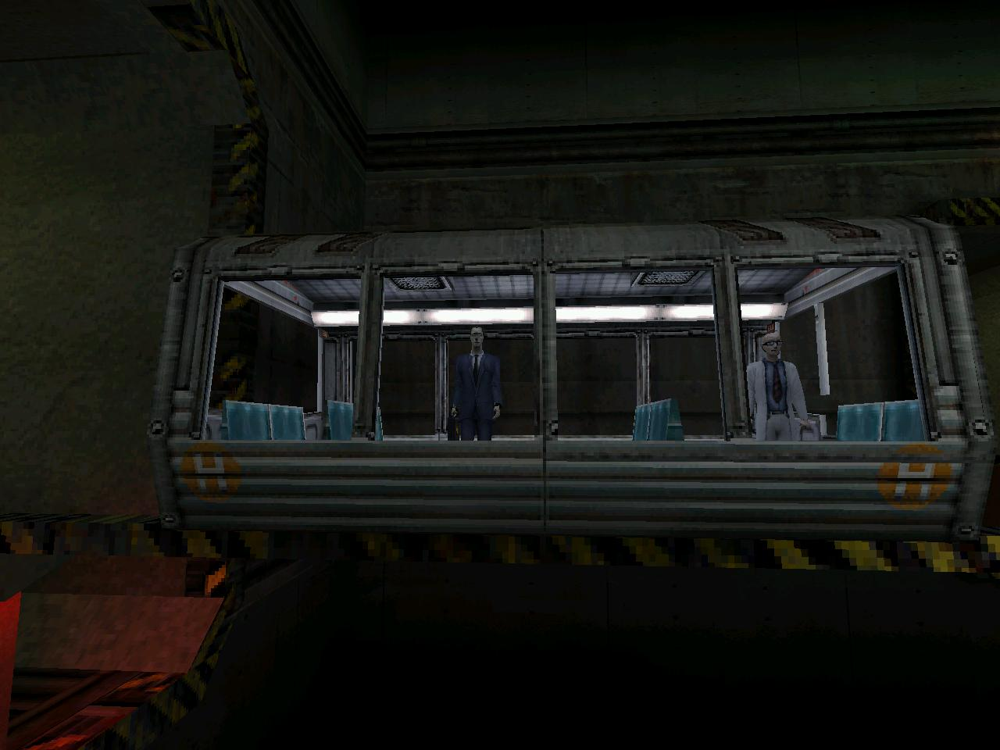
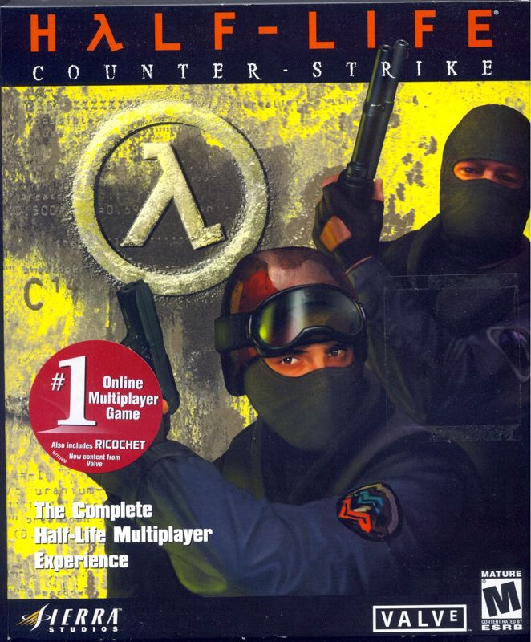

+++
title = "跑、想、射、活"
date = "2022-05-18T05:33:50-03:00"
readingTime = true
+++

Half-Life改變了你對人生的思考方式，它不是一個普通的第一人稱射擊遊戲。作為一個玩Doom長大的人，第一次玩Half-Life的時候，我獲得了童年最重要的領悟之一：如果你真的動腦子，其實不需要那麼高的技術，而且有時候跑路其實特別管用，也沒什麼不好意思的（這也是我當時喜歡在PlayStation上玩生化危機的原因之一，雖然那遊戲嚇死我了）。

那是一個陽光明媚的週日，我大概4歲，哥哥讓我去遊戲店（對，物理上走過去）買Counter-Strike（當時布宜諾斯艾利斯網咖裡最火的遊戲）。於是我跟爸爸一起去了。當時有兩個Counter-Strike（普通版和Condition Zero），我把兩個都帶回了家，把第一張光碟塞進電腦，然後出現了一個Half-Life的畫面。

我注意到CD盒上寫著"Half-Life Counter-Strike"，心想："Half-Life是什麼？聽起來很好玩！:)"

那張（顯然是盜版的）CD實際上包含了：

- [Half-Life](https://store.steampowered.com/app/70/HalfLife/)
- [Half-Life: Opposing Force](https://store.steampowered.com/app/50/HalfLife_Opposing_Force/)
- [Half-Life: Blue Shift](https://store.steampowered.com/app/130/HalfLife_Blue_Shift/)
- [Team Fortress Classic](https://store.steampowered.com/app/20/Team_Fortress_Classic/)
- [Ricochet](https://store.steampowered.com/app/60/Ricochet/)
- [Deathmatch Classic](https://store.steampowered.com/app/40/Deathmatch_Classic/)
- [Counter-Strike](https://store.steampowered.com/app/10/CounterStrike/)

我把所有東西都裝了，先開啟Half-Life因為我更喜歡它的畫風。開始玩，然後...媽的，一列火車出現了。我從來沒在遊戲裡坐過會動的火車，而且我喜歡火車，所以我很開心。火車花了很長時間才到站，感覺這遊戲一點都不趕，我太喜歡了！

幾分鐘後，世界他媽炸了 D:！但遊戲的畫風太好看了 :D！所以我就在那裡跑來跑去，像個穿著酷炫"Hazardous Environment Suit"的科學家，而現實中我穿著蜘蛛俠的衣服，所以感覺很有代入感。

我撿了一根不錯的撬棍，按了個按鈕叫電梯，無意中引發了一個故障，害死了幾個科學家同事 :(

D:

:((( 我剛才做了什麼??

然後我開始自衛。在Half-Life中，戰鬥是一個需要解決的謎題；不是那種你得死了才能知道某些事情然後重試、靠蠻力通關的遊戲（我一直在想，不死的話你怎麼知道那些事情）。在Half-Life裡，你必須真正珍惜你的生命，把它當作你擁有的最重要的東西。

你是一個科學家，不是殺手。看到威脅時，先跑去保護自己，然後思考如何利用你的工具、環境和知識來對付敵人。如果你真的不需要殺誰，就不殺，但如果需要，你已經有了計劃。

這個遊戲有一些有意思的資訊：

- 你可能會不小心殺死生命。
- 真出大事的時候，你的老闆會腳底抹油溜掉。
- 政府不會來救你，你也不應該信任他們。
- 一個人可以對世界產生真正的影響，所以你很重要。
- 世界是混亂的，很多事件都不是計劃好的。
- 沒有人真的清楚發生了什麼。
- 別指望有人告訴你該做什麼；自己想，自己試，大膽搞。
- 當一切都完蛋的時候，你可能有朋友幫你，但如果沒有，就只剩你自己和幾把酷炫的武器了。
- 你對自由的追尋可能永遠不會結束。
- 你最大的敵人似乎是一個想給你工作的跨維度官僚。
- 說話沒那麼重要。

<video src="/en/blog/half-life/mashup.webm" width="100%" preload="metadata" autoplay muted playsinline loop></video>

我見過很多人玩Half-Life很費勁，因為他們期待遊戲告訴他們該做什麼，如果遊戲不說，他們就什麼都不做！這個遊戲的核心就是好奇心和嘗試新想法，而這遠遠超出了故事本身。

這個遊戲充滿了mod和一群嘗試各種奇怪東西的社群，Valve（Half-Life背後的公司）允許並推動這些，激發了一大波藝術創意和各種玩法。這就是為什麼我們有這麼多基於Half-Life的遊戲。我覺得這些東西很多都消失了，我們都被關在各家的封閉生態裡了。

如果你沒玩過Half-Life，試試看。遊戲列表：

- [Half-Life](https://store.steampowered.com/app/70/HalfLife/) (有個炸裂的重製版叫[Black Mesa](https://store.steampowered.com/app/362890/Black_Mesa/))
- [Half-Life 2](https://store.steampowered.com/app/220/HalfLife_2/)
- [Half-Life 2: Episode One](https://store.steampowered.com/app/380/HalfLife_2_Episode_One/)
- [Half-Life 2: Episode Two](https://store.steampowered.com/app/420/HalfLife_2_Episode_Two/)
- [Half-Life: Alyx](https://store.steampowered.com/app/546560/HalfLife_Alyx/) (VR遊戲)

可選的：

- [Half-Life: Opposing Force](https://store.steampowered.com/app/50/HalfLife_Opposing_Force/) (從你的一個敵人——士兵的視角玩HL1的故事。我特別喜歡它的畫風、武器，還有那些賊帥的坦克和直升機)
- [Half-Life: Blue Shift](https://store.steampowered.com/app/130/HalfLife_Blue_Shift/) (從你的一個朋友——保安的視角玩HL1的故事)
- [Half-Life 2: Lost Coast](https://store.steampowered.com/app/340/HalfLife_2_Lost_Coast/) (就是一個短小的技術演示，感覺像做了一個莫名其妙的夢)

你還應該玩[Portal](https://store.steampowered.com/app/400/Portal/)和[Portal 2](https://store.steampowered.com/app/620/Portal_2/)，因為它們在同一個宇宙裡，但它們是不同的遊戲，各有各的精彩。
