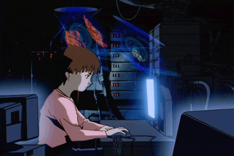
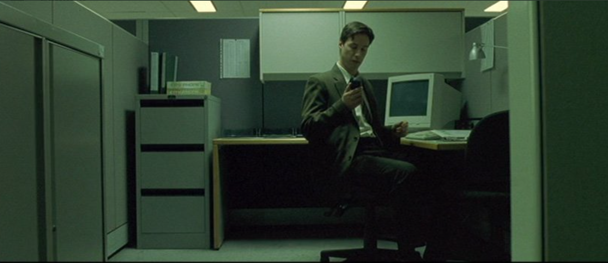

+++
title = "別投資自己"
date = "2024-05-12T09:03:20-03:00"
readingTime = true
+++

我在金融Twitter上看到有人問一個知名博主那個老生常談的問題"我該投資什麼"，還說自己很年輕，對方回覆說最好別想那些，"投資自己"就好了。

<!--more-->

下面我從幾個角度說說這個觀點為什麼扯淡。

我對各種建議一直都不太感冒，因為可靠的建議壓根就不存在。"我該投資這個還是那個？""Android和iOS哪個更安全？""用app好還是網頁好？""該不該用VPN？"所有這些問題本身都無法回答，答案永遠是看情況。每個人都是獨一無二的，對每個個體來說答案都不同。而且同一個人，明天答案可能就變了。這就是為什麼搞技術的不背答案，而是學怎麼理解需求、找到解決方案。

我先用一個特別簡單的道理來質疑"投資自己"這個想法：網際網路上免費知識的數量是無限的。那什麼擋著你了？就是你會不會找、會不會用，再加上你就一個腦子、一天就 24 小時。你真能砸多少錢在自己身上？其實沒多少。

來個極端的：如果我給一個15歲的人一百萬美元，他怎麼投資自己？找世界上最貴的大學，同時報幾個專業？那有什麼意義？總有一個點，你花的錢買到的已經不再是教育了，你也沒有能力吸收那麼多。而且，認識人的好處也不是對所有人都適用的；對你也許是，但對很多人不是。說得都挺美的，但別真被人當冤大頭。

很多國家都有一個問題：太多人"投資自己"投過頭了，投資回報不如預期，現在揹著一身債。我相信應該學你想學的、感興趣的東西，但你必須知道沒有什麼能保證它會"有用"，也沒人應該給你這種保證。賺錢最重要的不是學一百萬種東西，而是能死磕一件事，不斷迭代。

說白了，人最值錢的是時間；"投資自己"需要的首先是時間，不是錢。

讓年輕人遠離投資是犯罪，因為他們的時間優勢太強了。牛到什麼地步呢——最好連**嬰兒**都開始投資。

比如，如果一個人出生時你每月捐100美元，全部投入股票和比特幣，到18歲的時候，靠著複利，他就能有自己的房子了。你想想，一個小孩以後一輩子就只用花錢吃飯交網費，這優勢多大。

年輕人沒錢的時候最該做的就是去碰壁，但得是主動去碰。不動腦子往問題上砸錢不是什麼好主意。就像建議"走安全路線"是個壞主意一樣，無腦硬撞也是。

儲蓄和投資的價值觀即使在你什麼都沒有的時候也是有用的。如果你在擁有什麼之前不去想這些，當你擁有的時候就不知道怎麼管理（查查大多數彩票中獎者的下場，或者那些腳下有無限財富的國家是怎麼崩潰的）。如果你對投資一無所知、毫無經驗，連工作對你有沒有用都成問題。這就是為什麼你看到有人幹了45年，退休後覺得自己被坑了。

13歲的時候，我對經濟突然著了迷，想弄明白為什麼我們有通貨膨脹。我驚訝地發現這個問題相當蠢。我就開始找有什麼東西發行量和需求都穩定，瞭解了黃金，從那時起開始買黃金，但後來意識到我才 13 歲，一個月賺 50 刀，投黃金純屬腦子有病。我又沒什麼錢要保值。那時我意識到最好的做法是把所有東西押在高風險的東西上，於是全部投入了比特幣。從那一刻起，我賺的每一分錢都用來買更多比特幣，就算歸零也無所謂，我想明白了自己的優勢：我才 13，虧了又怎樣。

那段時間，我也開始賭博和網上下注，贏了也輸了很多錢。後來我才意識到這經歷有多牛逼：我體驗了一個50歲男人在賭場押上房子的感覺，但提前了40年，而且不用一槍崩了自己。我對風險的理解從此和我那些朋友完全不在一個維度，這種認知別人花多少錢都買不到，而我趕早體驗了，代價還低得離譜。

別問已經贏了的人該怎麼做，你的優勢不一樣。折騰才是人生回報最高的事，而現在對你來說是最便宜的時候。

低買高賣。

人都是吃了虧才長記性。在那種保護不了資本的社會，資本根本不會有，不是沒了，是根本沒人想著去攢。如果你不理解市場是怎麼運作的，你就無法想像通往你想實現的目標的道路，甚至不知道自己想要什麼。

這適用於所有事情，比如身體也一樣，不是哪個訓練計劃更好的問題，而是真正理解漸進超負荷原則，腦子裡得有那個進步曲線，知道自己往哪走。否則，你根本不明白自己他媽到底圖個啥。

