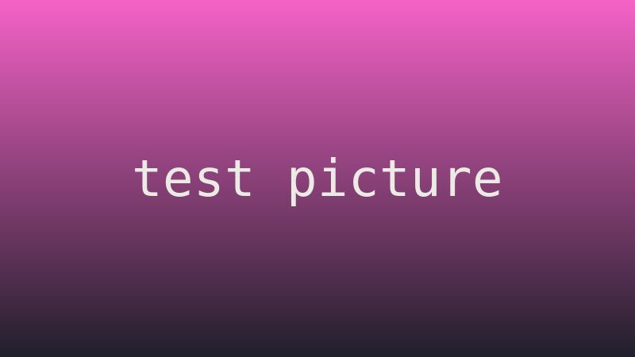
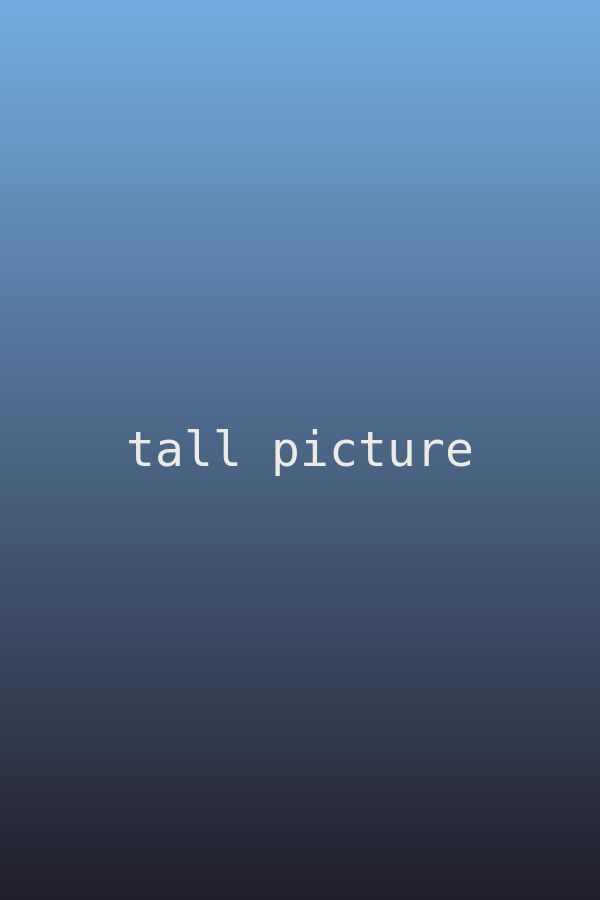

+++
title = "測試文章"
date = "2020-01-01T12:00:00-03:00"
readingTime = true
noindex = true
hideComments = true
sitemap = { disable = true }
# Hidden: it doesn't show in lists, the home page or RSS. Open it by its URL.
[build]
  list = "never"
+++



這是一篇用來試東西的隱藏文章。它不會出現在任何列表裡，搜尋引擎會跳過它，也沒有評論。文章裡放了一篇帖子可能有的各種東西：標題、長段落和短段落、列表、引用、程式碼、表格和圖片。它夠長，可以滾好幾屏，所以閱讀條、讀書的貓和儲存的位置都有地方發揮。

往下滾幾屏，再回到最上面，等一下。閱讀條上會在你剛才的位置出現一個爪印。讀到一半時重新整理頁面，貓會在你儲存的位置等你。

## 短標題

中文的詞和詞之間沒有空格，所以引用連結按字數來截。逗號、句號、“雙引號”、‘單引號’、問號？感嘆號！還有像3.14、42和1,000,000這樣的數字。裡面也混了Half-Life這樣帶連字元的英文。

這一段很普通，沒什麼特別的。它在這裡是為了讓標題之間有足夠的文字，這樣貓每到一個新的部分都能說出它的名字，閱讀條上的刻度也不會擠在一起。

## 一個貓必須截短的非常非常長的部分標題

貓會用氣泡說出每個部分的名字，但太長的名字會被截短。這個標題是故意寫長的。

- 一個帶[專案頁面連結](/zh-tw/projects/)的專案。
- 一個帶[外部連結](https://example.com/)的專案。
- 一個帶**粗體**、*斜體*和`行內程式碼`的專案。
  - 一個巢狀的專案。
  - 另一個巢狀的專案。
- 最後一個專案。

### 小一點的標題

小標題在閱讀條上也有刻度。這裡是一段引用：

> 跑、想、射擊、活下去。這段引用夠長，在大多數螢幕上會佔兩行，看起來像真的一樣。

還有一些程式碼：

```js
// 一個程式碼塊，用來檢查它是橫向滾動，而不是把頁面撐寬。
const cat = { name: "neko", lives: 9, favorite: "yarn", says: () => "nya~ mrrp? meow =^.^= this line is long on purpose" };
console.log(cat.says());
```

## 表格和其他塊

| 什麼 | 在哪 | 為什麼 |
| --- | --- | --- |
| 閱讀條 | 頁面頂部 | 顯示你讀到哪了 |
| 爪印 | 閱讀條上 | 標出你剛才的位置 |
| 刻度 | 閱讀條上 | 每個部分一個 |
| 引用連結 | 選中的文字旁邊 | 直接在那裡開啟文章 |

1. 一個有序列表。
2. 第二項。
3. 第三項。

---

上面那條線是水平線。

## 晚一點載入的圖片

下面的圖片在你靠近時才載入。它已經有尺寸了，所以出現時頁面不會跳。



## 用來引用的長段落

在任何段落裡選幾個字，就會出現一個複製連結的按鈕。試試跨兩個段落選，或者從一長串文字的中間開始選，看看難一點的情況。

這是一段用來選字的長段落。它會寫上好一陣子，這樣開頭、中間和結尾都有很多字可以選。敏捷的棕色狐狸跳過了懶狗，懶狗醒過來，伸了個懶腰，又在太陽下睡著了。某個地方有一隻貓看著這一切，什麼也不做，這是最像貓的事。

緊接著第一段的另一段長段落，用來跨兩段選字。它沒講什麼特別的事。下雨的下午適合讀書，晴天的早上適合散步，深夜適合睡覺，雖然沒人真的這麼做。明天又是新的一天。

再來一段，一長串沒有空格的字：啊啊啊啊啊啊啊啊啊啊啊啊啊啊啊啊啊啊啊啊啊啊啊啊啊啊啊啊啊啊啊啊啊啊啊啊啊啊啊啊啊啊啊啊啊啊啊啊啊啊。

## 更多可以滾動的文字

這個部分是為了讓文章更長，這樣閱讀時間有幾分鐘，閱讀條也走得夠慢，看得清楚。讀要花時間，測試也是。喘口氣，往下滾一點，看看貓在做什麼。

你滾動的時候，貓在閱讀條上走。你停下來，它就坐下。到了最後，它會走到下一篇文章那裡，問你要不要讀。隨時點它，看看還剩多少。

把貓沿著閱讀條拖動，就能在文章裡移動。把它從閱讀條上拉下來，就是把它拿起來，它會待在你放下的地方，直到下一頁。

這個頁面上其他訪客的幽靈貓也坐在閱讀條上，在它們各自讀到的位置。用兩個視窗開啟這個頁面就能看到。

## 結束

就這些。滾到最底下，貓會指向另一篇文章。
